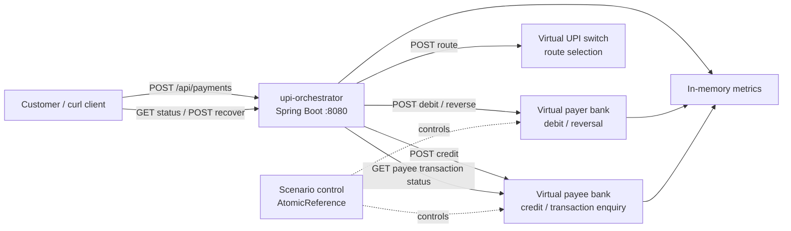
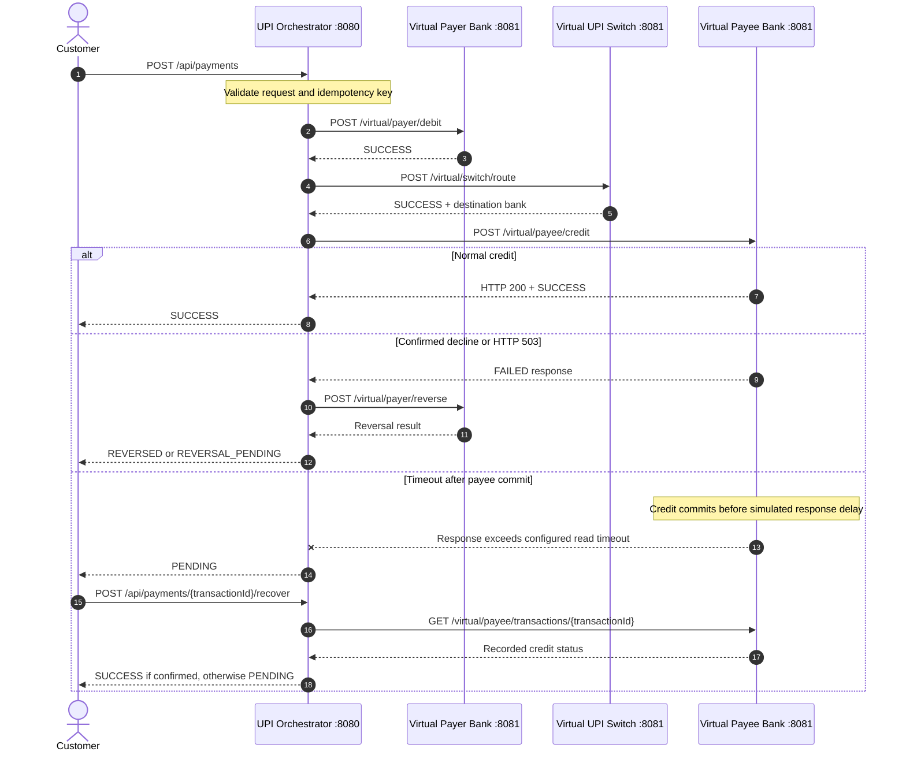

# UPI Service Virtualization & Resilience Testing Platform


## How UPI Service Virtualization Works


A local proof of concept for exploring payment orchestration, idempotency, failure injection, timeout recovery, and application-level metrics across two independent Spring Boot services.

This project is a **simulated payment network**. It does not connect to NPCI, banks, UPI rails, or any real payment system. It is not a production UPI implementation.

## Problem statement

A payment orchestrator has to coordinate a payer debit, route selection, and payee credit across separate services. Network failures can leave the caller unsure whether a downstream operation committed. Blindly retrying a credit can duplicate a transfer, while reversing an already credited payment can leave both sides with funds.

This POC demonstrates the normal payment flow and selected failures using in-memory virtual banks. It records payment state, supports idempotency keys, exposes a payee transaction enquiry for recovery after a credit timeout, and publishes lightweight metrics.

## Features

- Two independently runnable Spring Boot applications on ports 8080 and 8081.
- Payment orchestration with idempotency-key validation and payment status enquiry.
- Virtual payer debit, payee credit, UPI route selection, and payer reversal.
- Per-transaction locking inside the orchestrator and duplicate protection in the virtual bank services.
- Configurable read/connect timeouts for orchestrator calls to the virtual network.
- Explicit recovery of `PENDING` payments by querying the payee bank. Recovery does not issue another credit.
- Scenario controls and in-memory application metrics.

### Supported scenarios

| Scenario | Simulated behavior | Current orchestrator outcome |
| --- | --- | --- |
| `NORMAL` | Debit, route, and credit succeed | `SUCCESS` |
| `PAYER_BANK_UNAVAILABLE` | Payer debit endpoint returns HTTP 503 before debiting | `PENDING`; the debit result is treated as uncertain |
| `PAYEE_BANK_DECLINED` | Payee returns HTTP 200 with business status `FAILED` | Payer reversal is attempted; normally `REVERSED` on successful reversal |
| `PAYEE_BANK_UNAVAILABLE` | Payee credit endpoint returns HTTP 503 | Payer reversal is attempted; normally `REVERSED` on successful reversal |
| `PAYEE_TIMEOUT_AFTER_CREDIT` | Payee commits the credit, then delays its response beyond the orchestrator read timeout | `PENDING`; no automatic reversal or credit retry. Use the recovery endpoint to query the payee record |

A successful recovery changes `PENDING` to `SUCCESS`. If the payee has no record, the payment remains `PENDING`; absence of a record is not treated as proof that a timed-out request cannot still commit.

## Architecture



## End-to-end payment sequence

### End-to-End Payment Sequence

The following sequence diagram illustrates the complete UPI payment lifecycle handled by the UPI Orchestrator.

It covers three major execution paths:

1. **Successful Payment:** The payer bank successfully debits the amount, the UPI switch routes the transaction, and the payee bank confirms the credit.
2. **Failure and Reversal:** If the payee bank confirms a failed credit, the orchestrator initiates a reversal to refund the payer.
3. **Timeout and Recovery:** If the payee bank commits the credit but its response times out, the transaction remains `PENDING`. The orchestrator uses a recovery API to query the payee bank's recorded transaction status instead of blindly retrying the credit or initiating an automatic reversal.

This design demonstrates idempotency, failure handling, reversal management, timeout handling, and transaction recovery in a simulated UPI ecosystem.




## Applications

### `upi-orchestrator` — port 8080

Accepts customer payment requests, checks idempotency keys, and coordinates payer debit, switch routing, and payee credit through `RestClient`. It stores transaction state in an in-memory repository, exposes payment status and explicit recovery endpoints, and reports counters, status gauges, and processing latency.

### `upi-virtual-network` — port 8081

Provides REST endpoints for a virtual payer bank, virtual payee bank, and route-selection service. It owns the scenario selector and simulated account state. For `PAYEE_TIMEOUT_AFTER_CREDIT`, the payee service commits the credit before the controller delays its response.

## Technology stack

- Java 17 language target (the Maven POMs set `java.version` to 17; a compatible JDK 17 or later is required).
- Spring Boot 4.1.2, Spring MVC, and Spring `RestClient`.
- Maven Wrapper (Maven 3.10.0 distribution configured in each app).
- JUnit 5 and Spring Boot test support, including Mockito-based tests.
- In-memory `ConcurrentHashMap`, `AtomicReference`, `LongAdder`, `AtomicLong`, and per-transaction locks.

No database, Kafka, Docker, Kubernetes, external monitoring platform, or real UPI integration is included.

## Prerequisites

- JDK 17 or later on `PATH` (`java -version`).
- A terminal with `curl` for API examples.
- Network access on the first Maven Wrapper run so it can download Maven and required dependencies.
- Ports 8080 and 8081 available.

The two folders are independent Maven projects; there is no root aggregator POM.

## Local setup and run

From the project checkout, use two terminals.

**Terminal 1 — virtual network:**

```bash
cd upi-virtual-network
./mvnw spring-boot:run
```

**Terminal 2 — orchestrator:**

```bash
cd upi-orchestrator
./mvnw spring-boot:run
```

The orchestrator expects the virtual network at `http://localhost:8081`. Its default timeouts are configured in `upi-orchestrator/src/main/resources/application.properties`:

```properties
virtual.network.connect-timeout=2s
virtual.network.read-timeout=1s
```

The payee delay for `PAYEE_TIMEOUT_AFTER_CREDIT` defaults to 3000 ms and is configurable in `upi-virtual-network/src/main/resources/application.properties`:

```properties
scenario.payee-timeout-after-credit.delay-ms=3000
```

A quick health check for the virtual network:

```bash
curl http://localhost:8081/virtual/health
```

## API reference and examples

### Orchestrator APIs (`localhost:8080`)

| Method | Path | Purpose |
| --- | --- | --- |
| `POST` | `/api/payments` | Create or replay a payment by idempotency key |
| `GET` | `/api/payments/{transactionId}` | Read current payment state |
| `POST` | `/api/payments/{transactionId}/recover` | Query payee status and recover a `PENDING` payment |
| `GET` | `/api/metrics` | Read in-memory payment metrics |
| `POST` | `/api/network-test/route` | Development helper that submits a fixed switch-route example |

Create a payment:

```bash
curl -i -X POST http://localhost:8080/api/payments \
  -H 'Content-Type: application/json' \
  -d '{"idempotencyKey":"demo-payment-001","payerVpa":"alice@demo","payeeVpa":"bob@demo","amount":1000.00}'
```

Example response:

```json
{
  "transactionId": "TXN-<generated-id>",
  "status": "SUCCESS",
  "message": "Payment completed successfully",
  "amount": 1000.00
}
```

Retry the same request with the same key to get the existing transaction. Reusing that key with different payer, payee, or amount is rejected.

Check status or request recovery using the `transactionId` from the payment response:

```bash
curl http://localhost:8080/api/payments/<TRANSACTION_ID>
curl -i -X POST http://localhost:8080/api/payments/<TRANSACTION_ID>/recover
```

### Virtual-network APIs (`localhost:8081`)

| Method | Path | Purpose |
| --- | --- | --- |
| `GET` | `/virtual/health` | Health check |
| `POST` | `/virtual/payer/debit` | Debit a virtual payer account |
| `POST` | `/virtual/payer/reverse` | Reverse a previously successful debit |
| `POST` | `/virtual/switch/route` | Determine destination bank from payee VPA |
| `POST` | `/virtual/payee/credit` | Credit a virtual payee account |
| `GET` | `/virtual/payee/transactions/{transactionId}` | Enquire about a recorded payee credit; returns 404 if none is recorded |
| `GET` | `/virtual/admin/scenario` | Read active scenario |
| `PUT` | `/virtual/admin/scenario?scenario={SCENARIO}` | Activate a scenario |
| `POST` | `/virtual/admin/scenario/reset` | Reset to `NORMAL` |
| `GET` | `/virtual/admin/metrics` | Read in-memory virtual-network metrics |

The scenario API examples below include activating and resetting a failure scenario:

```bash
curl -i -X PUT 'http://localhost:8081/virtual/admin/scenario?scenario=PAYEE_BANK_DECLINED'
curl http://localhost:8081/virtual/admin/scenario
curl -i -X POST http://localhost:8081/virtual/admin/scenario/reset
```

Direct payee credit example (normally the orchestrator calls this):

```bash
curl -i -X POST http://localhost:8081/virtual/payee/credit \
  -H 'Content-Type: application/json' \
  -d '{"transactionId":"TXN-direct-demo-001","payeeVpa":"bob@demo","amount":1000.00}'
```

Direct payee status enquiry:

```bash
curl -i http://localhost:8081/virtual/payee/transactions/TXN-direct-demo-001
```

Direct payer debit and matching reversal example (these calls mutate the demo account balance):

```bash
curl -i -X POST http://localhost:8081/virtual/payer/debit \
  -H 'Content-Type: application/json' \
  -d '{"transactionId":"TXN-direct-payer-001","payerVpa":"alice@demo","amount":1000.00}'

curl -i -X POST http://localhost:8081/virtual/payer/reverse \
  -H 'Content-Type: application/json' \
  -d '{"transactionId":"TXN-direct-payer-001","payerVpa":"alice@demo","amount":1000.00}'
```

Direct route-selection example:

```bash
curl -i -X POST http://localhost:8081/virtual/switch/route \
  -H 'Content-Type: application/json' \
  -d '{"transactionId":"TXN-route-demo-001","payerVpa":"alice@demo","payeeVpa":"bob@demo","amount":1000.00}'
```

### Failure injection and recovery

Set one scenario at a time. The selection is in memory and applies globally to virtual-network requests until reset.

**Confirmed payee decline:**

```bash
curl -X PUT 'http://localhost:8081/virtual/admin/scenario?scenario=PAYEE_BANK_DECLINED'
# Submit a payment using the POST /api/payments example above.
# Virtual payee returns FAILED; the orchestrator attempts reversal and normally returns REVERSED.
```

**Payee unavailable (HTTP 503):**

```bash
curl -X PUT 'http://localhost:8081/virtual/admin/scenario?scenario=PAYEE_BANK_UNAVAILABLE'
# Submit a payment. Expected: reversal after the confirmed 503; final status is usually REVERSED.
```

**Payer unavailable (HTTP 503 before debit):**

```bash
curl -X PUT 'http://localhost:8081/virtual/admin/scenario?scenario=PAYER_BANK_UNAVAILABLE'
# Submit a payment. Current orchestrator behavior is PENDING because the debit call throws an HTTP error.
```

**Timeout after payee credit:**

```bash
curl -X PUT 'http://localhost:8081/virtual/admin/scenario?scenario=PAYEE_TIMEOUT_AFTER_CREDIT'
# Submit a payment and retain its transactionId. Expected initial status: PENDING.
curl -i http://localhost:8081/virtual/payee/transactions/<TRANSACTION_ID>
curl -i -X POST http://localhost:8080/api/payments/<TRANSACTION_ID>/recover
# If the credit is recorded, recovery returns SUCCESS. If absent, it remains PENDING.
curl -X POST http://localhost:8081/virtual/admin/scenario/reset
```

Always reset the scenario when finished. Scenario reset does not reset account balances or the in-memory transaction history; restarting the virtual-network app resets those values.

### Metrics

```bash
curl http://localhost:8080/api/metrics
curl http://localhost:8081/virtual/admin/metrics
```

Example orchestrator response (values vary with requests):

```json
{
  "totalPaymentRequests": 2,
  "uniqueTransactions": 1,
  "successfulPayments": 1,
  "failedPayments": 0,
  "pendingPayments": 0,
  "reversedPayments": 0,
  "reversalPendingPayments": 0,
  "inProgressPayments": 0,
  "payeeTimeoutOccurrences": 0,
  "duplicateIdempotencyRequests": 1,
  "completedPaymentRequests": 2,
  "totalPaymentProcessingTimeNanos": 12000000,
  "averagePaymentProcessingLatencyNanos": 6000000
}
```

Example virtual-network response:

```json
{
  "totalVirtualBankRequests": 2,
  "payerDebitRequests": 1,
  "payeeCreditRequests": 1,
  "successfulCredits": 1,
  "declinedCredits": 0,
  "payerReversals": 0,
  "payeeStatusEnquiries": 0,
  "simulatedHttp503Responses": 0,
  "simulatedTimeouts": 0,
  "duplicateOperationsPrevented": 0
}
```

Orchestrator status metrics are current in-memory gauges; request, duplicate, and timeout values are counters. Latency is cumulative nanoseconds and an arithmetic average over completed payment requests, including duplicate requests. Virtual `totalVirtualBankRequests` is the sum of debit, credit, reversal, and payee status-enquiry requests.

## Automated tests and compilation

Run commands in each app directory; the projects build independently.

```bash
cd upi-virtual-network
./mvnw test
./mvnw -DskipTests compile

cd ../upi-orchestrator
./mvnw test
./mvnw -DskipTests compile
```

## Known limitations and production considerations

- **Simulation only:** there is no NPCI or real bank integration, UPI protocol certification, settlement, authentication, or financial ledger.
- **In-memory state:** accounts, transactions, idempotency, reversals, scenarios, and metrics are lost on restart. Multiple app instances do not share locks or deduplication records.
- **Reversal retry:** a transaction left in `REVERSAL_PENDING` has no dedicated retry/recovery endpoint yet.
- **Ambiguous empty responses:** an empty payer debit response is currently marked `FAILED`; an empty payee credit response can trigger a reversal. A production system should reconcile these outcomes before deciding whether to fail or refund.
- **No payer debit enquiry:** recovery currently queries the payee only. An ambiguous payer-debit outcome cannot be reconciled by the current API.
- **Idempotency scope:** orchestrator payment requests compare key, payer, payee, and amount in the current process; virtual payee duplicate transaction IDs return cached results without validating changed credit details.
- **Metrics:** values reset on restart, are not exported to a monitoring backend, and do not include latency histogram buckets/percentiles. Metrics and scenario administration endpoints have no authentication configured.
- **Error mapping:** the orchestrator's `IllegalArgumentException` handler currently returns HTTP 404, including for invalid/reused request details; HTTP 400 would be more appropriate for client validation errors.
- **Local demo data:** virtual services seed `alice@demo` and `bob@demo`; there is no read-only account-balance API.

These limitations are intentionally documented so the project is presented as a local resilience-testing POC, not a production payment platform.
